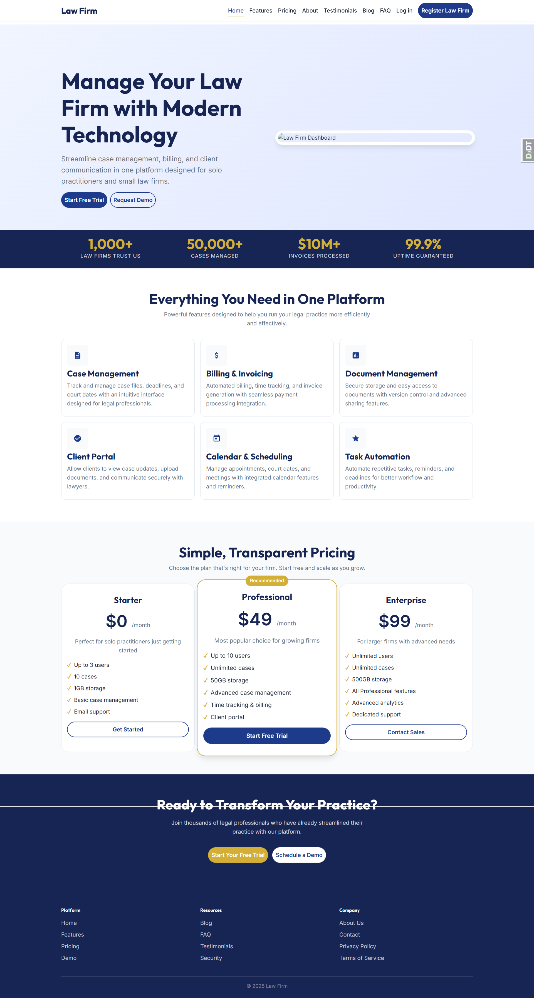
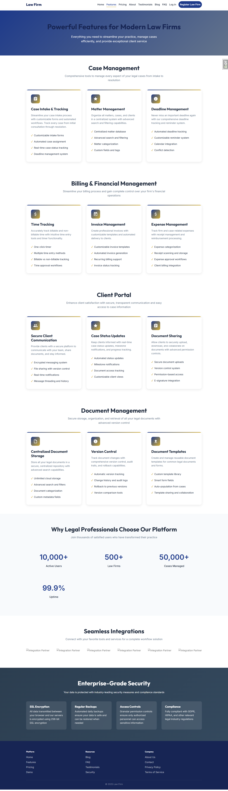
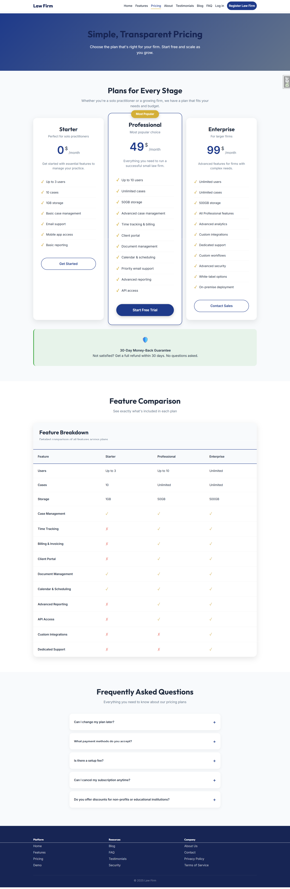
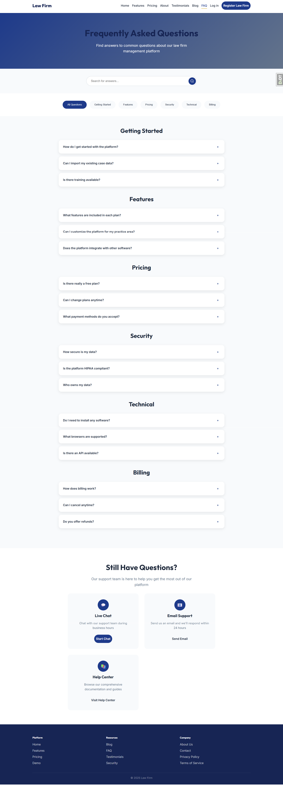
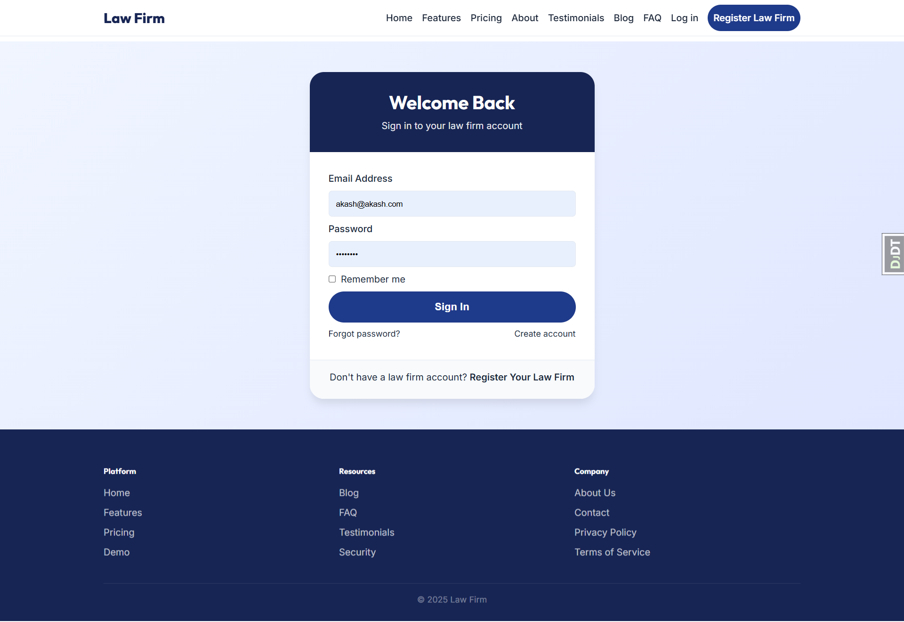
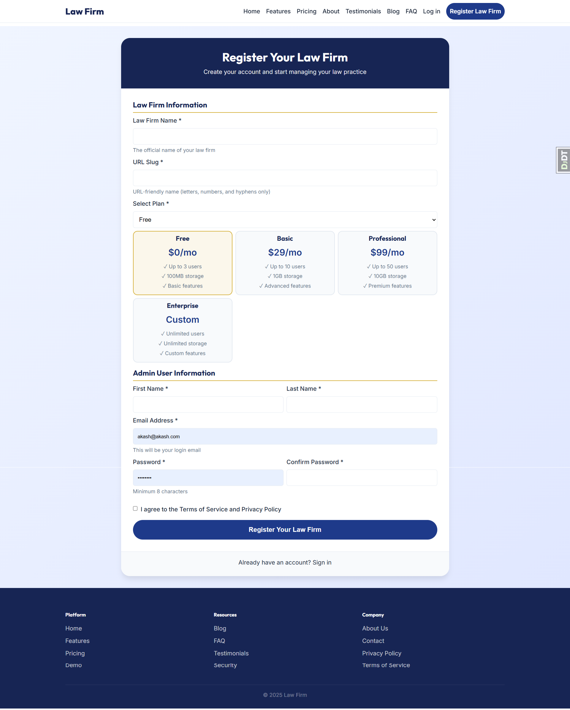
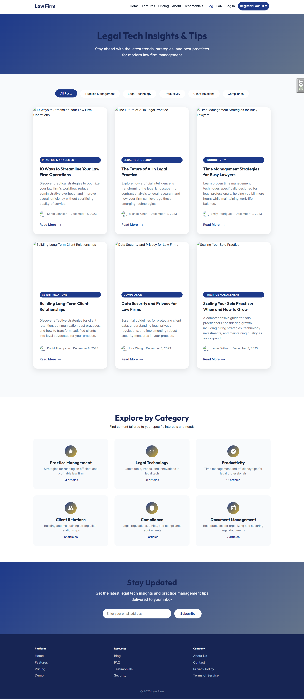

# LawFlow: Multi-Tenant Law Practice Management System

LawFlow is a comprehensive, multi-tenant law practice management system built with Django. It provides everything law firms need to manage cases, clients, documents, billing, and legal research in one secure, isolated environment.



## 👋 Free Newsletter
[Sign up for updates](https://buttondown.com/lithiumsaas) to get the latest features and updates!

## 🚀 Features

### Core Law Practice Management
- **Multi-Tenant Architecture**: Complete data isolation between law firms
- **Case Management**: Track cases with types (Civil, Criminal, Corporate, Family, etc.)
- **Client Management**: Comprehensive client profiles with case history
- **Document Management**: Version-controlled document storage with categorization
- **Billing & Invoicing**: Complete billing system with time tracking and expense management
- **AI Legal Research**: Powered by Google Gemini for legal research assistance
- **User Role Management**: Admin, Lawyer, Paralegal, Billing Manager, Staff roles
- **Audit Trails**: Complete audit logging for compliance and security

### Technical Features
- Django 5.1 & Python 3.13
- Installation via [uv](https://github.com/astral-sh/uv), [Pip](https://pypi.org/project/pip/) or [Docker](https://www.docker.com/)
- User authentication via [django-allauth](https://github.com/pennersr/django-allauth)
- Static files configured with [Whitenoise](http://whitenoise.evans.io/en/stable/index.html)
- Styling with [Bootstrap v5](https://getbootstrap.com/)
- Debugging with [django-debug-toolbar](https://github.com/jazzband/django-debug-toolbar)
- DRY forms with [django-crispy-forms](https://github.com/django-crispy-forms/django-crispy-forms)
- Custom 404, 500, and 403 error pages

## 📸 Application Screenshots

### Home Dashboard


### Features Overview


### Pricing Plans


### Frequently Asked Questions


### User Authentication



### Blog Section


## Table of Contents
* **[Installation](#installation)**
  * [uv](#uv)
  * [Pip](#pip)
  * [Docker](#docker)
* **[Multi-Tenant Architecture](#multi-tenant-architecture)**
* **[Core Modules](#core-modules)**
  * [Case Management](#case-management)
  * [Client Management](#client-management)
  * [Document Management](#document-management)
  * [Billing & Invoicing](#billing--invoicing)
  * [Legal Research AI](#legal-research-ai)
  * [User Management](#user-management)
  * [Audit & Compliance](#audit--compliance)
* **[Next Steps](#next-steps)**
* **[Contributing](#contributing)**
* **[Support](#support)**
* **[License](#license)**

## 📖 Installation
LawFlow can be installed via uv, Pip, or Docker. To start, clone the repo to your local computer and change into the proper directory.

```
$ git clone https://github.com/wsvincent/lawflow.git
$ cd lawflow
```

### uv
You can use [uv](https://docs.astral.sh/uv/) to create a dedicated virtual environment.

```
$ uv sync
```

Then run `migrate` to configure the initial database. The command `createsuperuser` will create a new superuser account for accessing the admin. Execute the `runserver` command to start up the local server.

```
$ uv run manage.py migrate
$ uv run manage.py createsuperuser
$ uv run manage.py runserver
# Load the site at http://127.0.0.1:8000 or http://127.0.0.1:8000/admin for the admin
```

### Pip
To use Pip, create a new virtual environment and then install all packages hosted in `requirements.txt`. Run `migrate` to configure the initial database and `createsuperuser` to create a new superuser account for accessing the admin. Execute the `runserver` command to start up the local server.

```
(.venv) $ pip install -r requirements.txt
(.venv) $ python manage.py migrate
(.venv) $ python manage.py createsuperuser
(.venv) $ python manage.py runserver
# Load the site at http://127.0.0.1:8000 or http://127.0.0.1:8000/admin for the admin
```

### Docker

To use Docker with PostgreSQL as the database, update the `DATABASES` section of `django_project/settings.py` to reflect the following:

```python
# django_project/settings.py
DATABASES = {
    "default": {
        "ENGINE": "django.db.backends.postgresql",
        "NAME": "postgres",
        "USER": "postgres",
        "PASSWORD": "postgres",
        "HOST": "db",  # set in docker-compose.yml
        "PORT": 5432,  # default postgres port
    }
}
```

The `INTERNAL_IPS` configuration in `django_project/settings.py` must also be updated:

```python
# config/settings.py
# django-debug-toolbar
import socket
hostname, _, ips = socket.gethostbyname_ex(socket.gethostname())
INTERNAL_IPS = [ip[:-1] + "1" for ip in ips]
```

And then proceed to build the Docker image, run the container, and execute the standard commands within Docker.

```
$ docker compose up -d --build
$ docker compose exec web python manage.py migrate
$ docker compose exec web python manage.py createsuperuser
# Load the site at http://127.0.0.1:8000 or http://127.0.0.1:8000/admin for the admin
```

## 🏢 Multi-Tenant Architecture

LawFlow implements a robust multi-tenant architecture that allows multiple law firms to use the same application while maintaining complete data isolation:

- **Data Isolation**: Each tenant's data is completely isolated from others
- **Custom Branding**: Each law firm can customize their instance with their logo, colors, and branding
- **Independent Configuration**: Each tenant has their own settings, users, and preferences
- **Scalable Design**: Easily add new law firms without additional infrastructure
- **Security**: Tenant-specific access controls and audit trails

## 📋 Core Modules

### Case Management
- Track cases with comprehensive metadata
- Support for multiple case types (Civil, Criminal, Corporate, Family, Real Estate, IP, Tax, etc.)
- Case status tracking (Open, Closed, Pending, Suspended, Appealed, Settled)
- Event tracking for hearings, filings, meetings, and deadlines
- Lawyer assignment and case history

### Client Management
- Complete client profiles with contact information
- Case history and relationships
- Professional information and company details
- Notes and communication tracking
- Soft delete functionality for data retention

### Document Management
- Secure document storage with tenant isolation
- Version control and document history
- Categorization (Contracts, Evidence, Court Filings, Discovery, etc.)
- Access level controls (Public, Internal, Confidential, Restricted)
- Full-text search and tagging
- Integration with cases and clients

### Billing & Invoicing
- Comprehensive time tracking with billable hours
- Expense management and categorization
- Automated invoice generation
- Payment tracking and reconciliation
- Role-based billing rates
- Tax calculation and reporting

### Legal Research AI
- AI-powered legal research using Google Gemini
- Query types: Case Law, Statutes, Regulations, Legal Analysis
- Context-aware research with case and client information
- Source citation and relevance scoring
- Research session management
- Token usage tracking and cost management

### User Management
- Role-based access control (Admin, Lawyer, Paralegal, Billing Manager, Staff)
- Tenant-specific user management
- Customizable permissions per role
- Activity tracking and audit logs

### Audit & Compliance
- Comprehensive audit logging for all actions
- Data retention policies
- Compliance reporting
- Security event tracking
- Tenant-specific audit trails

## Next Steps

### For Law Firms
- Configure your firm's branding and settings
- Set up user accounts and roles
- Import existing client and case data
- Configure billing rates and invoicing templates
- Set up document categories and access controls

### Technical Enhancements
- Add environment variables using [environs](https://pypi.org/project/environs/)
- Add [gunicorn](https://pypi.org/project/gunicorn/) as the production web server
- Update the [EMAIL_BACKEND](https://docs.djangoproject.com/en/4.0/topics/email/#module-django.core.mail) and connect with a mail provider
- Make the [admin more secure](https://opensource.com/article/18/1/10-tips-making-django-admin-more-secure)
- Configure [Redis](https://redis.io/) for improved caching and session management
- Set up [Celery](https://docs.celeryproject.org/) for background task processing

### Legal Industry Specific
- Implement e-filing integrations with court systems
- Add calendar integration with court scheduling
- Configure compliance templates for different jurisdictions
- Set up automated deadline calculations based on court rules
- Implement client portal for secure document sharing

## 🤝 Contributing

Contributions, issues, and feature requests are welcome! See [CONTRIBUTING.md](https://github.com/wsvincent/lawflow/blob/master/CONTRIBUTING.md).

## ⭐️ Support

Give a ⭐️ if this project helped you!

## License

[The MIT License](LICENSE)

---

> This project was formerly known as _DjangoX_ but was renamed to _LawFlow_ to reflect its focus on law practice management.

Law Management
Key Features:

Client Request Process
Matter Process
Lawyer create Process
Client Create Process
Invoice Management
Using this module you can handle every type of law matters. "Law ERP" includes: * Client Requests, * Manage Matters, * Manage Customers, * Law Practice Area, * Document management, * Trial Management, * Lawyer Information, * Opposition Lawyers and Parties Details, * Judge Information, * Act/Article Management, * Victim Information, * Results, * Courts, * Invoice Management, * Case/Matter PDF Report.

Law Management app

Feature 1: Client Request Process
*Overview:*

A lawyer,Help desk officer and Law admin users can be create all configuration

A lawyer,Help desk officer can add the client request.

Law admin can request, approve and reject client requests.

Only law admin user can approve and reject client requests also create matter,lawyer,client

Client is created automatically in client menu after approved the client request
*Purpose*

The Client can request from the listed legal services.
*Flow Chart*


Feature 2: Matter Process
*Overview*

Law admin user can create,approve,reject and reopen the client matter details
Invoice is created from view option from InProgress, Approved and Closed stage
*Purpose*

The matter is used to manage the acts,articles,opposition lawyer and documents details
*Flow Chart*


Feature 3: Lawyer create Process
*Overview:*

Law admin can create Lawyer.
Lawyers can specify the practice area and fees based on an hour,trial or fixed.
The lawyer will have many other details such as their Experience, Qualification and Personal Information.


Feature 4: Client create Process
*Overview:*

Client is created automatically in client menu after approved the client request. Also manual created from client menu using Is Client checkbox


Feature 5: Invoice Management
*Overview:*

Invoice created from view option under the matter.
Invoice form view is open up while click on "Create Sales invoice" button
Customer and Payment type auto appear with sale invoice form view.
Just add matter,qty and price details of the matter and confirm the sale invoice.
Make payment once confirm the invoice

------------
Generated Test Credentials
Default Password for ALL users: password123

Tenant 1: Gonzalez Law Office
Admin: aaron.ford.8@example.com / password123
Lawyer: deborah.miller.8@example.com / password123


--
Problem Fixed
The issue was that lawyers couldn't access their panel because the TenantContextMiddleware wasn't properly retrieving tenant context from the session when accessing URLs without tenant slugs.

Solution Implemented
Enhanced TenantContextMiddleware: Updated the middleware to properly handle tenant detection from session and user relationships when tenant is not set in the URL.

Fixed Import Issues: Resolved Tenant model import problems in the middleware.

Updated Login Guide: Added the correct lawyer credentials from the seed data.

Key Changes Made
1. Middleware Fix (core/middleware.py)
Enhanced tenant detection logic to check session first, then user relationship
Added proper error handling for invalid tenant sessions
Fixed import issues with Tenant model
2. Updated Credentials (SIMPLE_LOGIN_GUIDE.md)
Added newly created lawyer credentials: emily.bryant.8@example.com / password123
Added accountant and assistant credentials from the same tenant
Provided clear testing scenarios
Working Credentials
The following credentials now work properly:

Lawyer: emily.bryant.8@example.com / password123
Accountant: joshua.rivera.8@example.com / password123

Assistant: jeffrey.bennett.8@example.com / password123

Verification
Seed data command successfully creates tenants, users, clients, cases, and billing data
Lawyers can now log in and access their panel at /lawyer-panel/ without tenant slug requirements
The middleware properly sets tenant context from session data
Role-based redirects work correctly for all user types
The login system is now fully functional with simplified URLs that don't require tenant slugs, while maintaining proper tenant isolation and security.